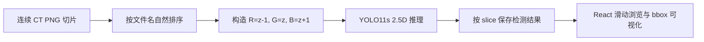

# RadScout v2.3.2

基于 **YOLO11s + 3-slice 2.5D 输入**的连续 CT 切片肺结节检测原型。

项目使用 LUNA16 subset0-6，将相邻轴向切片编码为：

```text
R = z-1
G = z
B = z+1
```

模型在检测中心层 `z` 时可以同时利用上下层信息。Web 端支持一次上传连续
PNG/JPG 切片、逐层推理、滑动浏览，并在当前切片上显示检测框。

> 当前版本是本科项目/作品集级原型，目标是验证 2.5D 医学影像检测流程，
> 不是完整 3D CT 检测系统。

## 项目成果

### 模型指标

验证集结果来自：
`backend/outputs/yolo25d_3slice_metrics.json`

| 指标 | 结果 |
|---|---:|
| Precision | **0.7359** |
| Recall | **0.7294** |
| mAP50 | **0.7435** |
| mAP50-95 | **0.3858** |
| 最佳记录 Epoch | **31** |

以上为 YOLO 目标检测指标，不是普通分类 accuracy，也不代表临床诊断准确率。

### 数据集规模

| 项目 | 数量 |
|---|---:|
| 扫描 CT volumes | 623 |
| 匹配到标注的 volumes | 428 |
| Train / Val volumes | 342 / 86 |
| Train / Val 图像 | 3543 / 937 |
| Positive images | 2019 / 537 |
| Negative images | 1524 / 400 |
| Train / Val seriesuid 重叠 | **0** |

训练集和验证集按 `seriesuid` 划分，避免同一个 CT volume 同时进入两边。

## 为什么使用 2.5D

单张 CT 切片无法充分表现目标在层间的连续性。例如血管截面和小结节在单层上
可能具有相似外观，但上下相邻层能够提供额外结构信息。

RadScout v2.3.2 没有直接采用复杂的 3D CNN，而是将相邻三层映射到普通 RGB
图像的三个通道，从而：

- 保留相邻层面信息；
- 继续使用成熟的 Ultralytics YOLO11s；
- 避免修改 YOLO 输入层；
- 控制显存占用和工程复杂度；
- 兼容常规 PNG 数据集和 Web 推理。



## v2.3.2 修复内容

v2.3.2 重点修复了 2.5D 推理中的通道保留问题。

序列接口在 `main.py` 中构造三通道图像后，直接将 `PIL RGB` 输入 YOLO，
避免推理模块再次转换为灰度并复制三个相同通道。这样模型实际接收到的仍是：

```text
[z-1, z, z+1]
```

而不是：

```text
[z, z, z]
```

该问题的排查体现了医学影像项目中“训练输入与推理输入必须严格一致”的重要性。

## 主要功能

- 使用 SimpleITK 读取 LUNA16 `.mhd/.raw` CT volume；
- 将结节世界坐标转换为体素坐标；
- 使用肺窗 `[-1000, 400]` 进行 HU clip 和归一化；
- 生成 3-slice 2.5D PNG 与 YOLO normalized bbox；
- 按 `seriesuid` 划分训练集和验证集；
- 生成 bbox debug 图和三层对比图；
- 使用 YOLO11s、CUDA 和 AMP 训练；
- FastAPI 提供连续切片检测接口；
- React + Vite 实现多文件上传、切片滑动和 bbox 展示；
- 自动检查文件类型、切片数量和图像尺寸；
- 边界切片使用复制策略补齐上下文。

## 技术栈

| 模块 | 技术 |
|---|---|
| 深度学习 | PyTorch、Ultralytics YOLO11s |
| 医学影像 | SimpleITK、LUNA16 |
| 数据处理 | NumPy、Pandas、Pillow |
| 后端 | FastAPI、Uvicorn |
| 前端 | React、Vite、Canvas |
| 训练环境 | NVIDIA CUDA、AMP |

## 个人工作

- 完成 LUNA16 数据读取、坐标转换和肺窗预处理；
- 设计 `z-1 / z / z+1` 三通道 2.5D 数据表示；
- 构建 YOLO 检测数据集、负样本和 debug 可视化；
- 实现按 CT volume 划分 Train/Val，排除数据泄漏；
- 完成 YOLO11s GPU 训练、指标提取和权重管理；
- 开发 FastAPI 连续切片推理接口；
- 开发 React 切片浏览与检测框可视化页面；
- 排查并修复 RGB 输入被重复灰度化的问题；
- 保证训练、离线评估和 Web 推理采用一致的 2.5D 通道语义。

## 项目结构

```text
version2.3.2/
├─ backend/
│  ├─ main.py                         # FastAPI 入口与序列检测接口
│  ├─ models/
│  │  └─ yolo_inference.py            # YOLO 2D/2.5D 推理封装
│  ├─ training/
│  │  ├─ build_yolo25d_dataset.py     # 3-slice 数据集构建
│  │  ├─ train_yolo25d.py             # YOLO11s 训练入口
│  │  ├─ bbox_utils.py                # bbox 转换与 IoU 工具
│  │  └─ ct_patch_utils.py            # CT patch 工具
│  ├─ tools/
│  │  ├─ check_gpu.py                 # CUDA/PyTorch 环境检查
│  │  └─ export_subset9_series.py     # 导出演示切片序列
│  ├─ weights/                        # 本地模型权重，不提交 Git
│  ├─ outputs/                        # 训练指标，不提交 Git
│  └─ requirements.txt
├─ frontend/
│  ├─ src/
│  │  ├─ App.jsx
│  │  ├─ api.js
│  │  └─ components/
│  │     ├─ ImageUploader.jsx
│  │     ├─ SeriesViewer.jsx
│  │     └─ MetricsPanel.jsx
│  ├─ package.json
│  └─ vite.config.js
├─ datasets/                           # 生成数据集，不提交 Git
├─ test_series/                        # 本地演示序列，不提交 Git
└─ README.md
```

## 快速启动

### 1. 后端环境

本项目不在 `requirements.txt` 中固定 PyTorch CUDA wheel。请先根据本机环境安装
PyTorch，再安装其他依赖。

```powershell
cd backend

D:/Python/python.exe -m pip install torch torchvision torchaudio `
  --index-url https://download.pytorch.org/whl/cu128

D:/Python/python.exe -m pip install -r requirements.txt
D:/Python/python.exe tools/check_gpu.py
```

### 2. 准备模型权重

由于 GitHub 不适合直接提交大型模型文件，权重默认被 `.gitignore` 排除。

将训练得到的权重放到：

```text
backend/weights/yolo11s_25d_3slice_best.pt
```

### 3. 启动后端

```powershell
cd backend
D:/Python/python.exe main.py
```

服务地址：

```text
http://localhost:8000
http://localhost:8000/docs
```

### 4. 启动前端

```powershell
cd frontend
npm install
npm run dev
```

页面地址：

```text
http://localhost:5173
```

前端通过 Vite proxy 将 `/api` 请求转发到 `localhost:8000`。

## 数据集构建

LUNA16 目录需要包含：

```text
luna16/
├─ annotations.csv
├─ subset0/
├─ subset1/
├─ ...
└─ subset6/
```

构建命令：

```powershell
cd backend

D:/Python/python.exe training/build_yolo25d_dataset.py `
  --data_dir D:/python_gjw/radscout2/data/luna16 `
  --out_dir ../datasets/luna_yolo_25d_3slice `
  --subsets 0 1 2 3 4 5 6 `
  --img_size 512 `
  --neg_ratio 2 `
  --debug_count 100
```

输出包括：

- `images/train`、`images/val`
- `labels/train`、`labels/val`
- `debug/train`、`debug/val`
- `data.yaml`
- `split_summary.json`
- `uid_mapping.json`
- `build_log.json`

## 模型训练

```powershell
cd backend

D:/Python/python.exe training/train_yolo25d.py `
  --model yolo11s.pt `
  --data ../datasets/luna_yolo_25d_3slice/data.yaml `
  --epochs 100 `
  --imgsz 640 `
  --batch 8 `
  --device 0 `
  --workers 2 `
  --amp
```

训练完成后生成：

```text
backend/weights/yolo11s_25d_3slice_best.pt
backend/outputs/yolo25d_3slice_metrics.json
backend/runs/yolo25d_3slice/
```

## API

| 方法 | 路径 | 说明 |
|---|---|---|
| GET | `/api/health` | 检查服务、设备和权重加载状态 |
| POST | `/api/detect-series` | 上传至少三张连续切片并逐层检测 |
| POST | `/api/detect` | 单图调试接口，不是主要产品入口 |
| GET | `/api/metrics` | 返回模型评估指标 |

`/api/detect-series` 会：

1. 校验 PNG/JPG/JPEG 格式；
2. 按文件名自然排序；
3. 检查所有图像尺寸一致；
4. 为每个中心层构造三通道输入；
5. 对第一层使用 `[z, z, z+1]`；
6. 对最后一层使用 `[z-1, z, z]`；
7. 返回每个 `slice index` 对应的 bbox 列表。

## 当前限制

- 只处理用户导出的连续 PNG/JPG 切片；
- 暂不支持 DICOM 直接上传；
- 不是完整 3D volume 检测模型；
- 当前模型只检测肺结节类别；
- 尚未加入跨切片候选关联或追踪；
- PNG/JPG 不包含 pixel spacing，因此无法可靠计算物理尺寸；
- 数据仅使用 LUNA16 subset0-6；
- 权重与数据集因体积较大，不随 Git 仓库提交。

## 后续方向

- 加入 ResNet18 假阳性削减模块；
- 针对血管截面进行 hard-negative mining；
- 比较单层 2D、3-slice 2.5D 和 5-slice 方案；
- 增加 detection-level 阈值分析；
- 探索跨切片候选关联与连续性特征；
- 在更多外部 CT 数据上验证泛化能力。

