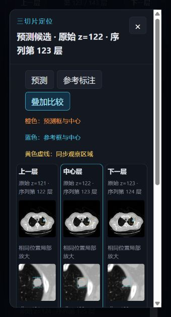

# RadScout v3.3.0 · 答辩最终版

基于 **YOLO11s、相邻三切片 2.5D 输入、FastAPI 与 React** 的肺部 CT 病灶检测和可视化项目。本次发布同步 2026 年 10 月 14 日整理的答辩最终材料。



## 当前版本

- 将 `z-1 / z / z+1` 映射至 R/G/B 通道，以中心层标注训练和检测。
- 默认使用重训的 **YOLO11s 第 90 轮**，显示阈值固定为 `0.5705289244651794`；具有空间信息时按 `3 mm` 分组。
- 点击候选可查看三切片、局部放大、预测框与参考标注；支持直径、半径估计及 PNG 像素间距导入。
- ResNet18 二阶段功能保留作历史工程对照，不作为下表测试成绩的主路径。

## 独立测试结果

subset9 包含 **87 例 CT、104 个结节、22,772 张切片**，已排除演示病例。阈值由验证集确定，没有用测试集调阈值。

| 指标 | 结果 |
|---|---:|
| 检出结节 | 92 / 104 |
| 敏感性 | 88.46% |
| 假阳性 / CT | 1.0115 |
| 七点 CPM | 0.8475 |
| 全部测试切片 mAP50 | 0.5124 |
| 全部测试切片 mAP50–95 | 0.2707 |
| 按训练规则取样 mAP50 / mAP50–95 | 0.6779 / 0.3479 |

结节级命中与框重叠指标衡量不同目标。详细配置和逐例结果见 [测试结果](docs/04_测试结果)。三切片单切片严格消融尚未完成，不能据此声称三切片必然优于单切片。

## 下载和运行

需要 Python 3.10+、Node.js 18+；CUDA 可用于加速，无 CUDA 时后端自动使用 CPU。

```bash
git clone https://github.com/june877/radscout-version2.3.2.git
cd radscout-version2.3.2
python -m pip install -r backend/requirements.txt
python scripts/download_models.py
npm --prefix frontend ci
```

模型权重保留原始内容，通过 [v3.3.0 Release](https://github.com/june877/radscout-version2.3.2/releases/tag/v3.3.0) 单独下载。下载脚本校验压缩包及两个权重的 SHA-256。离线使用时先下载附件，再运行 `python scripts/download_models.py --archive /path/to/RadScout-v3.3.0-models.zip`。

启动后端和前端（两个终端）：

```bash
python backend/main.py
npm --prefix frontend run dev -- --host 127.0.0.1
```

浏览器打开 `http://127.0.0.1:5173/`，点击加载演示病例，再开始检测。Windows 安装依赖和模型后，也可使用根目录的 `启动演示.cmd` / `停止演示.cmd`；PowerShell 可指定 `-PythonExe` 和 `-NodeExe`。启动器在本机优先使用已有的 `D:\Python\python.exe`，其他环境使用 PATH 中的 Python。

## 答辩材料

- [最终设计报告](docs/01_设计报告/CT肺部三切片病灶自动检测与可视化_设计报告_最终版.docx)
- [14 页答辩 PPT](docs/06_答辩PPT/CT肺部三切片病灶自动检测与可视化_答辩_14页版.pptx)，包含逐页讲稿，约 7–9 分钟。
- [答辩大纲](docs/05_PPT准备/PPT大纲与制作提示词.md)、[图片素材](docs/02_PPT素材)、[测试记录](docs/04_测试结果)。

报告和 PPT 保留本地最终文件的内容；封面个人信息按实际情况填写。历史实验 JSON、原交付说明中的绝对路径仅用于追溯，不是当前运行路径。`原稿备份` 和 8 页 PPT 保留以便核对，优先使用上述最终报告和 14 页 PPT。

## 目录

```text
backend/             API、三切片预处理、空间信息、训练代码与配置
frontend/            React + Vite 网页
demo/subset9_demo/   已查看的公开演示病例、元数据与参考标注
docs/                报告、PPT、素材及完整测试记录
scripts/             模型下载与校验
models-manifest.json 原始模型和附件校验值
start_demo.ps1       Windows 启动器
```

原始 LUNA16 训练体积、训练缓存及本机依赖不提交。模型输出尺寸来自预测框与像素间距换算，参考框来自结节中心和直径，均不等同于逐层精确分割。本项目用于课程设计和工程演示，不用于临床诊断。
